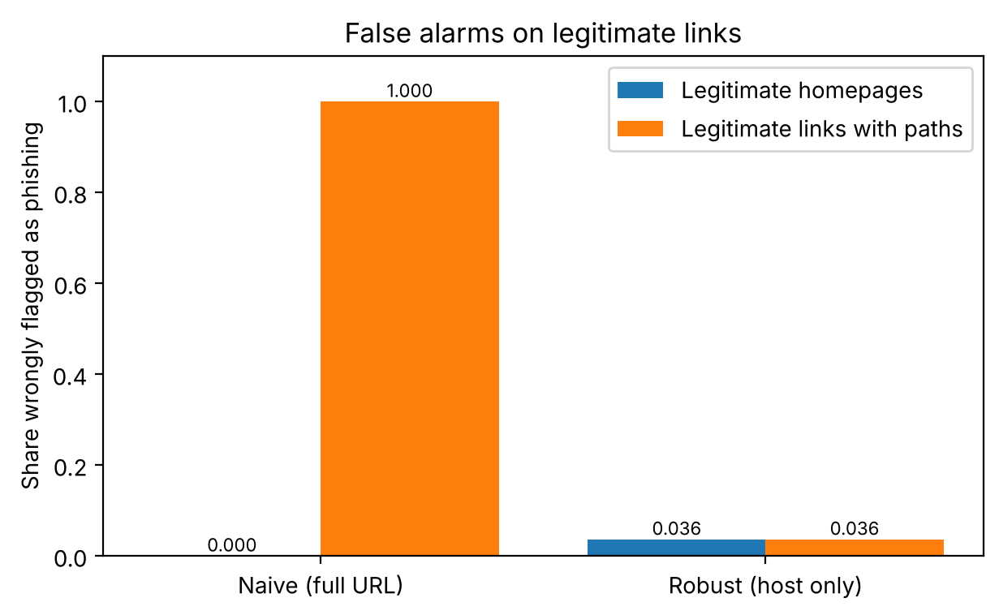
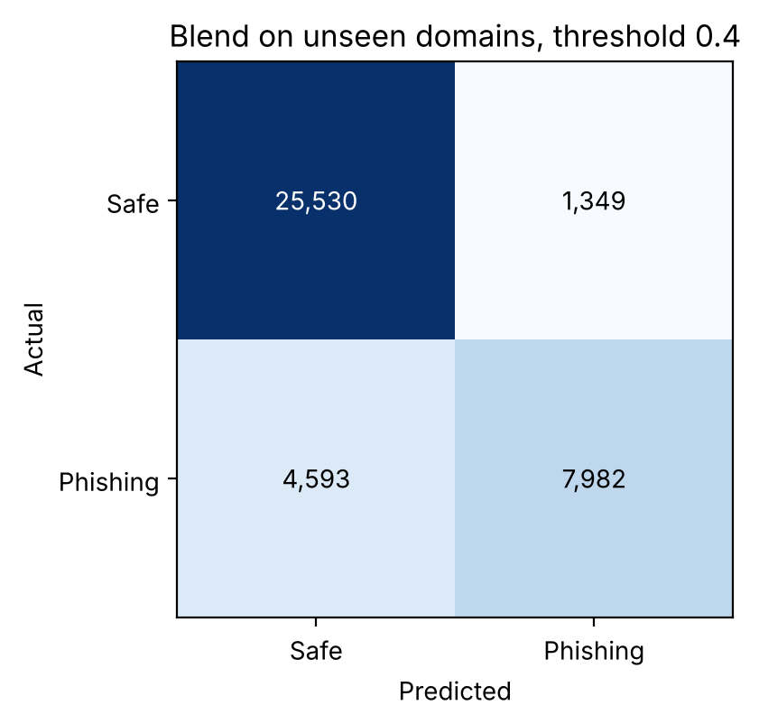
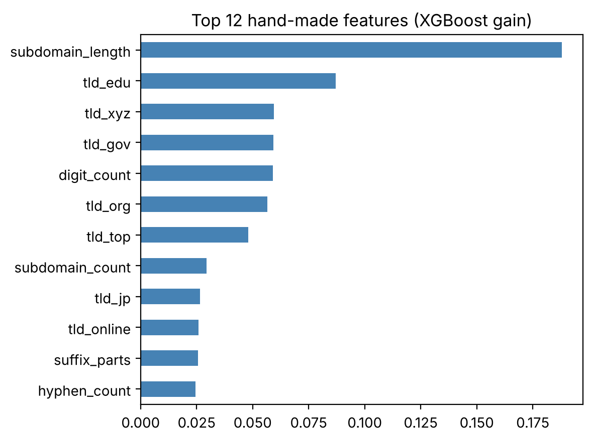

# QRShield: Real-Time Detection of Malicious QR Codes

QRShield checks the link inside a QR code before you open it. It reads the code with a laptop webcam or a phone camera, analyses the web address with machine learning and simple safety rules, and shows **SAFE**, **CAUTION** or **PHISHING** with the main reasons. The link itself is never visited.

**Author:** Aakash Tiwari, M.S. Cybersecurity, Rowan University

Full project report: [docs/QRShield_Project_Report.docx](docs/QRShield_Project_Report.docx)

## Why

QR code phishing ("quishing") is a growing attack: fake QR stickers on parking meters, posters and restaurant tables send people to login or payment pages that steal their details. A QR code hides the link until it is opened, so the check has to happen before the user taps it.

## How it works

```
Camera  ->  read QR code  ->  extract link  ->  trusted list / blocklist
                                           ->  shared platform rules
                                           ->  ML model (blend of two models)
                                           ->  SAFE / CAUTION / PHISHING + reasons
                                           ->  saved to local scan history (SQLite)
```

| Part | File | Tools |
|------|------|-------|
| Feature extraction from the host name | `qrshield/features.py` | tldextract, regular expressions |
| ML detector (blend of XGBoost and a character n-gram model) | `qrshield/detector.py` | XGBoost, scikit-learn |
| Rules, trusted list, blocklist, feedback | `qrshield/service.py`, `qrshield/storage.py` | SQLite |
| QR code reading | `qrshield/qr.py` | OpenCV |
| Laptop webcam scanner | `scanner.py` | OpenCV |
| Phone web app | `app.py` | Streamlit |
| Training and evaluation | `notebooks/1_train_qrshield.ipynb` | pandas, scikit-learn, XGBoost |

## Data

PhiUSIIL Phishing URL Dataset (Prasad & Chandra, 2024), UCI Machine Learning Repository: 235,795 URLs (134,850 legitimate, 100,945 phishing), 235,370 after removing duplicates. Only the URL text is used. Many of the other columns come from the web page's source code, which is not available when checking a QR code before opening it.

## Key finding: the dataset has shortcuts

| | Uses https | Has www | Has a path |
|---|---|---|---|
| Legitimate | 100% | 100% | 0% |
| Phishing | 48.6% | 41.8% | 28.2% |

Every legitimate URL in the dataset is a homepage like `https://www.domain.com`. A model trained on the full URL reached 99.8% accuracy on a random test split, but when ordinary paths were added to legitimate links (`/menu`, `/admissions`, `/order?table=12`), it flagged **100%** of them as phishing.



QRShield avoids this by:
1. Using only the **host** (for example `secure-paypa1-verify-account.xyz`), without scheme, `www.` or path
2. Removing links on **shared platforms** (link shorteners, Google Docs, SharePoint, free website builders) from training, since the dataset has no legitimate examples there, and handling them with rules
3. Evaluating with a **split by domain**, so the test set only contains domains the model has never seen

## Results

Test set: 39,454 links on regular domains never seen in training.

| Model | ROC AUC | Recall | Precision | False alarm rate |
|-------|---------|--------|-----------|------------------|
| XGBoost, hand-made features | 0.816 | 0.478 | 0.869 | 0.034 |
| Character n-grams | 0.879 | 0.606 | 0.884 | 0.037 |
| Blend of both | 0.877 | 0.567 | 0.926 | 0.021 |

(threshold 0.5)

| Threshold | Recall | Precision | False alarm rate |
|-----------|--------|-----------|------------------|
| 0.30 | 0.719 | 0.732 | 0.123 |
| 0.40 (used) | 0.635 | 0.855 | 0.050 |
| 0.50 | 0.567 | 0.926 | 0.021 |

The threshold is set to 0.4: catching phishing matters more than an occasional false alarm, but too many false alarms make people ignore warnings.





### Platform rules

| Link type | Verdict |
|-----------|---------|
| On the trusted list (exact host only) | SAFE |
| On the blocklist (host or any parent domain) | PHISHING |
| Link shortener (bit.ly, tinyurl ...) | CAUTION: hides the real destination |
| Shared service (docs.google.com, sharepoint.com ...) | CAUTION: anyone can publish |
| Free website platform (`*.web.app`, `*.github.io` ...) | PHISHING if the subdomain has a brand name or words like *login*, otherwise CAUTION |
| Everything else | ML model |

## Run it

```
pip install -r requirements.txt
```

1. Download the dataset into `data/` (see `data/README.md`), then run `notebooks/1_train_qrshield.ipynb` to train and save the models. Trained models are already included in `models/`.
2. Create test QR codes:
   ```
   python make_test_qr.py
   ```
3. Laptop webcam scanner:
   ```
   python scanner.py
   ```
   Q = quit, W = mark the last result as wrong, H = print recent scans
4. Phone web app:
   ```
   streamlit run app.py
   ```
   Open the Network URL on a phone connected to the same Wi-Fi and use **Upload QR image** to take a photo. The live **Scan with camera** tab needs HTTPS on phones, so use it after deploying (for example on Streamlit Community Cloud) or through an HTTPS tunnel.

The test QR codes point to made-up addresses. Do not open them.

## Privacy

Scan history is stored only in a local file, `qrshield.db`, which is excluded from the repository. For a public deployment, set `QRSHIELD_SAVE_HISTORY=false` so that no scanned links are stored.

## Limitations

- Phishing pages on a **compromised legitimate domain** look safe, because the host itself is trustworthy. Catching these needs the page content or a reputation service.
- On unseen regular domains the model catches about 63% of phishing links at a 5% false alarm rate. It should support, not replace, user caution.
- Legitimate URLs in the dataset are mostly popular homepages, so false alarm rates on small or new legitimate sites may be higher.
- Brand, keyword and platform lists are written by hand and need updating.

## Future work

- Attacker vs detector: test how easily phishing hosts can be changed to evade the model, then retrain with these examples (adversarial training)
- Detect physical tampering: a QR sticker pasted over a real one
- A FastAPI backend with a live phone scanner, deployed on Azure or AWS
- Add a domain age or reputation check

## References

- Prasad, A. & Chandra, S. (2024). PhiUSIIL: A diverse security profile empowered phishing URL detection framework based on similarity index and incremental learning. Computers & Security. Dataset: UCI Machine Learning Repository.
- Detecting Quishing Attacks with Machine Learning Techniques Through QR Code Analysis (2025). arXiv:2505.03451
